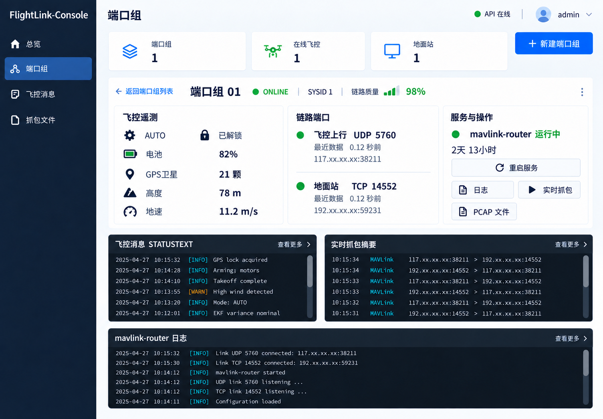
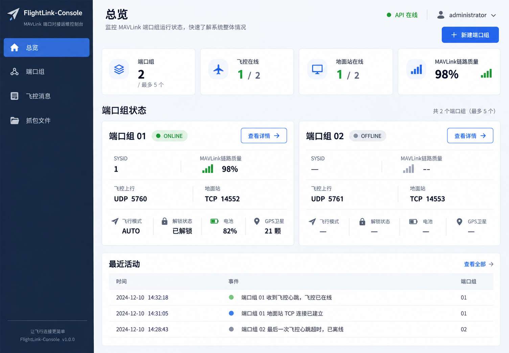
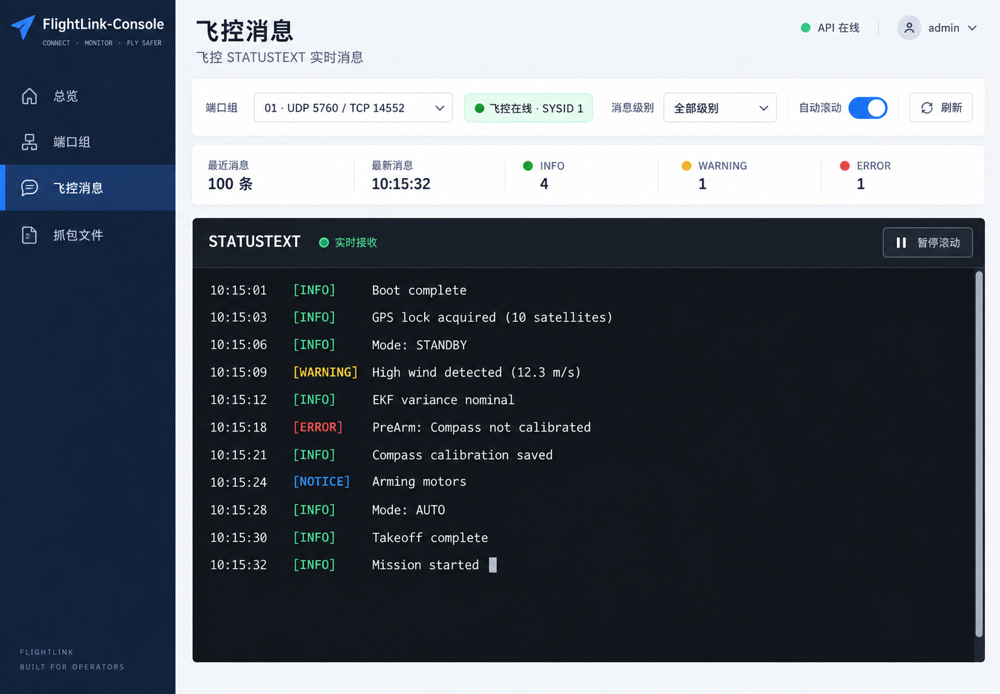
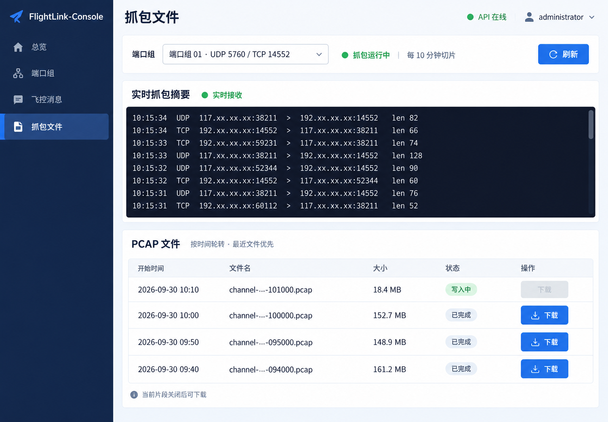

# FlightLink-Console 前端设计

状态：待用户审阅  
日期：2026-09-30

## 1. 目标与已确认约束

FlightLink-Console 前端为管理员提供 1–5 组 MAVLink 端口的状态总览与管理界面。通道身份由服务器端口组合确定，不把通道绑定为固定无人机设备身份。飞控仍通过 4G DTU 将 MAVLink UDP 发往 ECS，地面站按配置使用 TCP（默认）或 UDP。

本阶段目标：

- 登录管理员控制台，查看所有端口组并进入单组详情。
- 创建、修改、删除和重启端口组。
- 查看飞控、地面站、mavlink-router 和抓包状态。
- 展示飞控 `STATUSTEXT`、MAVLink 链路质量、实时抓包摘要和 PCAP 文件。

约束：

- 不显示 EC05-DNC 蜂窝信号强度，也不把 MAVLink 链路质量解释为 4G 信号。
- 不制作飞行记录或历史遥测分析页。
- 管理员账户没有网页注册流程，只能由后端 `ConsoleUseradd` 命令创建。
- 不制作阿里云安全组管理页面；安全组规则仍由后端按端口组同步。
- 首期真实 ECS、RAM 角色、DTU 和 QGC 端到端验收安排在前端完成后。

## 2. 技术栈

- Node.js LTS 与 npm：开发、依赖管理和构建；初始化时选用当时受支持的 LTS 版本。
- Vue 3、TypeScript、Vite：SPA 页面及静态构建。
- Vue Router：登录、总览、端口组、消息和抓包页面路由。
- Element Plus：表单、菜单、下拉框、对话框和通用控件；用项目自己的颜色、卡片和终端样式覆盖默认外观。
- 原生 Fetch API 封装：统一 API 基址、Cookie 凭据、JSON/二进制响应和错误处理；不把会话令牌放入 `localStorage`。
- Vue composables 管理页面数据与轮询；首期不引入 WebSocket、SSE、服务端渲染或额外 Node 服务。

采用桌面优先的控制台布局。侧栏、浅色数据卡片和深色终端面板构成主视觉；窄屏下侧栏折叠、卡片纵向排列、终端区域允许横向滚动。

## 3. 页面与导航

### 3.1 登录

用户名和密码提交到 `POST /api/v1/auth/login`。页面不提供注册、忘记密码或网页新增管理员功能。登录成功后进入总览；会话过期或受保护请求返回 401 时回到登录页。

### 3.2 总览

- 顶部只显示三个汇总数字：端口组数量、飞控在线数量、地面站在线数量。
- **不显示跨端口组 MAVLink 链路质量，也不以其他指标占用该位置。**
- 端口组卡片以端口组名称、飞控 UDP 端口、地面站协议/端口及在线状态为主；可显示该组自己的 SYSID、链路质量和关键遥测。
- 卡片点击后进入对应端口组详情。
- 保留“最近活动”区域，但首期只从当前页面轮询观察到的状态变化生成临时记录；不表示持久化事件历史，刷新页面后不保证保留。

### 3.3 端口组列表与单组详情

端口组列表可查看和选择已有端口组，并进入详情或新建端口组。详情页一次只展示一个端口组，标题使用端口组标签与端口号，不使用固定的 `UAV-01` 设备身份。

详情页信息：

- 飞控遥测：飞行模式、解锁状态、电池、GPS 卫星数量、海拔、相对高度和地速；缺失值显示为“—”。
- MAVLink 链路质量：小型从左向右递增的阶梯图标与百分比并列；不使用大面积卡片或长条仪表。
- 链路端口：飞控 UDP 入站端口、地面站 TCP/UDP 端口、对端地址、最近数据时间和各自连接状态。
- 服务状态：mavlink-router 与抓包服务状态、运行时长、日志/抓包文件入口、重启操作。
- 飞控消息、实时抓包摘要、mavlink-router 日志使用深色、等宽字体、可滚动终端面板。

端口组表单字段：飞控 UDP 端口、地面站端口、地面站协议（默认 TCP，可选 UDP）、启用状态。创建/编辑通过后端校验；删除前提示对应端口对；修改与删除结果要显示后端返回的运行和安全组状态。

### 3.4 飞控消息

- 可选端口组和消息级别，显示该通道最近的 MAVLink `STATUSTEXT`；级别筛选在前端对已获取的消息执行，后端接口只提供数量限制。
- 使用终端样式，严重级别以颜色区分，支持自动滚动开关和手动刷新。
- 首期不提供清空、导出或持久化飞行记录功能。

### 3.5 抓包文件

- 可选端口组；上部为终端样式的近实时抓包摘要。
- 下部列出该组 PCAP 文件的开始时间、文件名、文件大小和状态。
- 当前写入片段标记为“写入中”且不可下载；已关闭片段提供下载。
- 页面说明按 10 分钟轮转；不提供删除、单独启动或停止抓包操作。

## 4. 后端 API 对接

| 页面/动作 | API |
| --- | --- |
| 健康状态 | `GET /api/v1/health` |
| 登录、退出、恢复会话 | `POST /api/v1/auth/login`、`POST /api/v1/auth/logout`、`GET /api/v1/auth/me` |
| 总览和列表 | `GET /api/v1/channels` |
| 单组详情 | `GET /api/v1/channels/{id}` |
| 创建、修改、删除 | `POST /api/v1/channels`、`PUT /api/v1/channels/{id}`、`DELETE /api/v1/channels/{id}` |
| 重启路由 | `POST /api/v1/channels/{id}/restart` |
| 单组日志、飞控消息、报文 | `GET /api/v1/channels/{id}/logs`、`/messages`、`/packets` |
| PCAP 列表与下载 | `GET /api/v1/channels/{id}/captures`、`GET /api/v1/channels/{id}/captures/{file_name}` |

使用现有后端响应字段，不自行推导蜂窝信号。`security_group.state`、`runtime.state`、`capture_runtime.state` 及其错误字段均须呈现；HTTP 成功响应不代表这些子系统都已就绪。`monitor_state=unavailable`、服务状态 `unknown/failed`、端口组禁用和无人机离线要显示为不同状态。

## 5. 实时更新与错误处理

当前后端使用 REST 轮询，没有 WebSocket/SSE。首期建议的刷新节奏：

- 总览/端口组状态：每 3 秒。
- 打开的单组遥测详情：每 2 秒。
- 飞控消息和 mavlink-router 日志：每 2 秒。
- 实时抓包摘要：每 1 秒，仅在抓包页可见时。
- PCAP 文件列表：手动刷新或每 15 秒刷新。

页面隐藏时暂停轮询；同一资源不并行发起重复请求；请求失败时保留最近一次数据并显示“更新失败/数据可能过期”，恢复后继续轮询。所有受保护 API 请求携带 Cookie；401 清理前端管理员状态并导航到登录页。

## 6. 部署与网络

- Vue 构建产物由 ECS 上的 Nginx 以静态文件方式提供；Node.js 不作为生产常驻服务。
- Nginx 为网页和 `/api/` 提供同源入口；`/api/` 反向代理到 `http://127.0.0.1:8000`，前端使用相对 API 路径，不配置宽泛 CORS。
- Nginx 外网 HTTPS 监听 TCP `18443`。阿里云安全组由管理员手工添加 TCP `18443` 入方向规则，来源限为管理员公网 IPv4 `/32`。
- FastAPI 继续只监听 `127.0.0.1:8000`；不开放 TCP `8000` 或 `8080`。
- HTTPS 部署将 `FLIGHTLINK_SESSION_COOKIE_SECURE=true`。TLS 证书配置在实现/部署阶段按可用域名与证书方案确定。
- DTU UDP 端口与 QGC TCP/UDP 端口由后端按端口组规则管理，不由 Nginx 转发。

## 7. 不在本阶段实现

- 阿里云安全组独立管理页。
- 4G RSRP/RSRQ、信号百分比或对蜂窝链路的猜测。
- 飞行历史、轨迹、遥测持久化、长期活动审计。
- 浏览器内直接控制飞行器；飞行远控仍由 QGC 完成。
- WebSocket/SSE、服务端渲染和多用户角色权限系统。
- ECS、RAM、DTU、QGC 的真实连通性验收。

## 8. 样图

端口组详情：

总览：

注：这张总览原始样图仍包含已决定移除的全局 MAVLink 链路质量卡片；实现按本规范使用三个汇总卡片，不显示该全局指标。每个端口组卡片中的单组链路质量保留。

飞控消息：

抓包文件：

